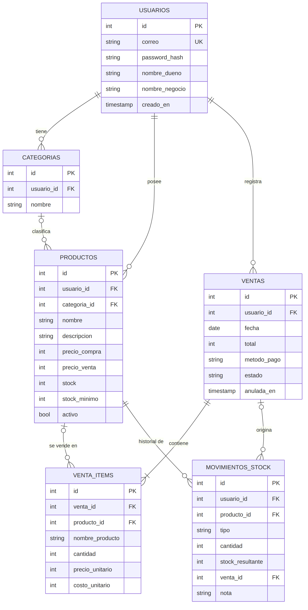

# Modelo de datos de Vendix

Diagrama entidad-relación: **`modelo-entidad-relacion.png`** (se edita desde `er.mmd`, formato Mermaid).
El script SQL completo está en **`../database/schema.sql`**.

## Tablas

| Tabla | Para qué sirve | Notas |
|---|---|---|
| `usuarios` | Cuenta de cada comerciante (un usuario = un negocio) | `correo` único. Guarda el hash de la contraseña, nunca la contraseña. |
| `categorias` | Categorías de productos de cada cuenta | Única por (`usuario_id`, `nombre`). Se crean solas al guardar un producto con una categoría nueva. |
| `productos` | Inventario | `precio_compra` (puede ser `NULL` en productos antiguos), `precio_venta`, `stock`, `stock_minimo`. `activo = 0` significa eliminado. |
| `ventas` | Cabecera de cada venta | `fecha` (día), `total`, `metodo_pago` (Efectivo / Transferencia / Tarjeta), `estado` (completada / anulada). |
| `venta_items` | Productos de cada venta | Guarda `nombre_producto`, `precio_unitario` y `costo_unitario` del momento de la venta. |
| `movimientos_stock` | Historial de cada cambio de stock | `tipo`: inicial, venta, anulacion, reposicion, ajuste. `cantidad` positiva entra, negativa sale. |

## Relaciones

- Un `usuario` tiene muchas `categorias`, `productos` y `ventas` (1 : N). Si se borra el usuario, se borra todo lo suyo (`ON DELETE CASCADE`).
- Una `categoria` clasifica muchos `productos` (1 : N). Si se borra la categoría, los productos quedan sin categoría (`SET NULL`).
- Una `venta` contiene uno o más `venta_items` (1 : N obligatorio).
- Un `producto` puede aparecer en muchos `venta_items` (1 : N). Si el producto desapareciera, el ítem conserva su nombre (`SET NULL`).
- Un `producto` tiene muchos `movimientos_stock`; una `venta` puede originar varios movimientos.

## Decisiones de diseño

1. **Precios como enteros.** El peso chileno no usa decimales, así que no hay errores de redondeo.
2. **Foto de la venta.** `venta_items` copia nombre, precio y costo. Por eso el historial y las ganancias pasadas no cambian
   si el comerciante edita o elimina el producto.
3. **Eliminación suave** de productos (`activo`), para no romper el historial.
4. **`stock` guardado en `productos` + historial en `movimientos_stock`.** Leer el stock es rápido y, además, cada
   cambio queda explicado (quién lo cambió, cuándo y por qué).
5. **`precio_compra` permite `NULL`** para convivir con productos creados antes de existir ese dato. Las estadísticas
   los dejan fuera de la ganancia y avisan, en vez de suponer un costo.
6. **Restricciones en la base** (`CHECK`): precios y stock no pueden ser negativos, cantidades > 0, método de pago y estado válidos.
   La base protege los datos aunque falle una validación del código.
7. **Índices** en las consultas más usadas: productos por cuenta, ventas por cuenta y fecha, ítems por venta y por producto.

## Cálculos derivados (no se guardan, se calculan con SQL)

- Ganancia por unidad = `precio_venta − precio_compra`.
- Invertido de un período = suma de `cantidad × costo_unitario` de los ítems vendidos.
- Ganancia de un período = lo vendido (solo ítems con costo) − invertido. Invertido + ganancia = total vendido.
- Valor del inventario = suma de `precio_compra × stock`; ganancia potencial = suma de `(precio_venta − precio_compra) × stock`.
