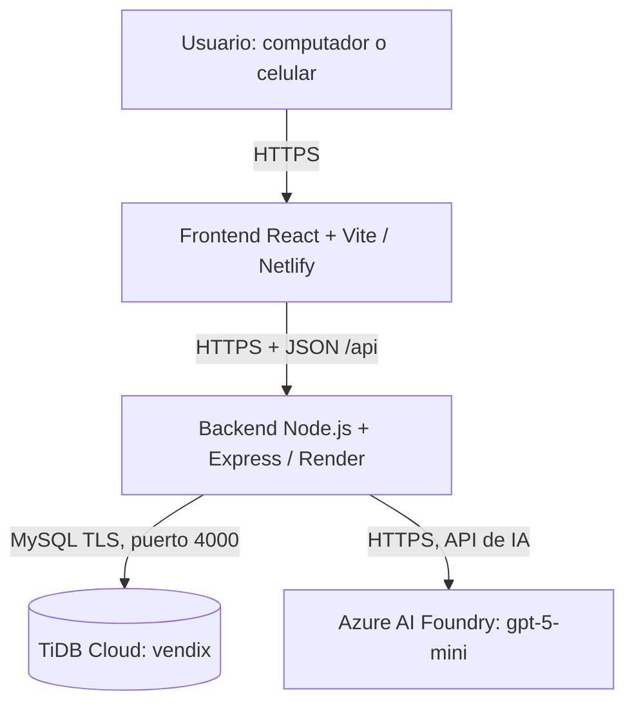

# Plan de despliegue — Vendix

**Proyecto APT (Capstone) · Ingeniería en Informática · Duoc UC Valparaíso**  
**Versión 1.0 · Actualizado: noviembre de 2026**

## 1. Objetivo

Documentar el despliegue de Vendix desde los entornos de desarrollo hacia servicios en la nube, dejando registrados la arquitectura publicada, la configuración realizada, las pruebas de verificación y las tareas de operación y mantenimiento.

El despliegue busca que la aplicación pueda utilizarse desde computadores y celulares mediante HTTPS, manteniendo el frontend, la API y la base de datos separados.

## 2. Alcance

Este plan cubre:

- Publicación del frontend React + Vite en Netlify.
- Publicación de la API Node.js + Express en Render.
- Migración de la base de datos MySQL a TiDB Cloud, compatible con el protocolo MySQL.
- Conexión cifrada entre Render y TiDB mediante TLS.
- Configuración de CORS para permitir que el frontend publicado consuma la API.
- Configuración de Azure AI Foundry para el asistente de Vendix.
- Verificación de funcionamiento desde navegador de escritorio y celular.

No incluye automatización de respaldos, monitoreo externo permanente, alta disponibilidad ni una política formal de recuperación ante desastres. Esas actividades quedan como tareas de operación pendientes.

## 3. Arquitectura desplegada

| Componente | Tecnología / servicio | Función | Dirección o referencia |
|---|---|---|---|
| Frontend | React 18, Vite 5, PWA, Netlify | Interfaz de usuario para computador y celular | https://provendix.netlify.app |
| Backend | Node.js, Express, Render Web Service | API REST, autenticación y lógica de negocio | https://vendix-backend-k6te.onrender.com |
| Base de datos | TiDB Cloud Starter, MySQL compatible | Persistencia de usuarios, productos, ventas y movimientos | Instancia `vendix-db`, región AWS São Paulo (`sa-east-1`), puerto 4000 |
| Asistente IA | Azure AI Foundry, despliegue `gpt-5-mini` | Respuestas del asistente con contexto del negocio | Endpoint de Azure AI configurado en el backend |

### 3.1 Flujo de comunicación

1. El usuario abre el frontend publicado en Netlify.
2. El frontend envía las solicitudes HTTP a `https://vendix-backend-k6te.onrender.com/api`.
3. Render ejecuta la API Node.js y valida las sesiones mediante JWT.
4. La API consulta TiDB Cloud mediante una conexión MySQL cifrada con TLS.
5. Cuando corresponde, el backend utiliza Azure AI Foundry para responder consultas del asistente.



## 4. Preparación y migración de la base de datos

### 4.1 Respaldo de MySQL

Antes de migrar se generó un respaldo local de la base `vendix` mediante `mysqldump`, incluyendo estructura y datos. El archivo original se conservó sin modificar.

Comando utilizado en Windows (adaptar la ruta del ejecutable si MySQL está instalado en otra ubicación):

```powershell
& "C:\Program Files\MySQL\MySQL Server 8.0\bin\mysqldump.exe" -u root -p --databases vendix --routines --triggers --events --result-file="$HOME\Desktop\vendix_backup.sql"
```

### 4.2 Preparación de TiDB Cloud

Se creó la instancia Starter `vendix-db` en AWS São Paulo (`sa-east-1`). Se configuró el acceso MySQL compatible y se descargó el certificado CA público requerido para TLS.

Se creó la base de datos `vendix` y se importaron las tablas y datos de la aplicación. La estructura migrada incluye:

- `usuarios`
- `categorias`
- `productos`
- `ventas`
- `venta_items`
- `movimientos_stock`

Durante la importación se detectó una incompatibilidad de codificación al enviar el archivo SQL mediante una canalización de PowerShell. Se utilizó el cliente MySQL con `--default-character-set=utf8mb4` para consultar y verificar las tablas y sus registros. Se confirmó la existencia de las seis tablas y se revisaron sus conteos.

### 4.3 Conexión TLS desde el backend

El backend se adaptó para aceptar la configuración TLS de TiDB:

- `DB_SSL=true` activa TLS.
- `DB_SSL_CA` indica la ruta del certificado CA.
- `src/db/mysql.js` carga el certificado y establece `minVersion: TLSv1.2`.
- El certificado CA se cargó en Render como **Secret File** con nombre `tidb-ca.pem`, disponible en `/etc/secrets/tidb-ca.pem`.

El certificado y las credenciales no se incorporaron al repositorio Git.

## 5. Despliegue del backend en Render

### 5.1 Repositorio y configuración

Repositorio: `https://github.com/danieldelta93/Proyecto-Capstone-backend`  
Rama: `main`  
Directorio raíz del servicio: `Codigo`

Configuración del Web Service:

| Campo | Valor |
|---|---|
| Nombre del servicio | `vendix-backend` |
| Runtime | Node |
| Región seleccionada en Render | Oregon (US West) |
| Plan utilizado durante el despliegue | Free |
| Build command | `npm ci` |
| Start command | `npm start` |

El despliegue inicial se completó correctamente desde el commit `10beb48` (`Preparar conexión segura con TiDB`). Render inició `node src/server.js` y marcó el servicio como `Live`.

### 5.2 Variables de entorno

Las variables se configuraron directamente en Render. No deben guardarse en Git ni incluirse en la documentación con sus valores secretos.

| Variable | Configuración |
|---|---|
| `PORT` | Render asigna el puerto de ejecución automáticamente |
| `DB_HOST` | Host entregado por TiDB Cloud |
| `DB_PORT` | `4000` |
| `DB_USER` | Usuario de TiDB Cloud |
| `DB_PASSWORD` | Contraseña de TiDB Cloud (secreto) |
| `DB_NAME` | `vendix` |
| `DB_SSL` | `true` |
| `DB_SSL_CA` | `/etc/secrets/tidb-ca.pem` |
| `JWT_SECRET` | Secreto aleatorio, privado y de al menos 32 caracteres |
| `JWT_EXPIRA` | `7d` |
| `ZONA_HORARIA` | `America/Santiago` |
| `CORS_ORIGENES` | `https://provendix.netlify.app,http://localhost:5173` |
| `LLM_API_KEY` | Clave privada de Azure AI Foundry |
| `LLM_BASE_URL` | `https://vendix-ai-resource.services.ai.azure.com/openai/v1` |
| `LLM_MODELO` | `gpt-5-mini` |

**Seguridad:** los valores reales de `DB_PASSWORD`, `JWT_SECRET` y `LLM_API_KEY` se administran únicamente en el panel de Render. No deben copiarse a este documento, al repositorio ni a capturas compartidas.

### 5.3 Certificado secreto

En Render se agregó un Secret File:

- Filename: `tidb-ca.pem`
- Ruta usada por la aplicación: `/etc/secrets/tidb-ca.pem`
- Contenido: certificado CA público descargado desde TiDB Cloud.

No se deben subir claves privadas locales como `vendix-key.pem` o `rootCA-key.pem`.

## 6. Despliegue del frontend en Netlify

### 6.1 Repositorio y configuración

Repositorio: `https://github.com/danieldelta93/Proyecto-Capstone-frontend`  
Rama: `main`  
Directorio base: `Codigo`

Configuración de compilación:

| Campo | Valor |
|---|---|
| Proyecto en Netlify | `provendix` |
| Build command | `npm run build` |
| Publish directory | `Codigo/dist` (ruta mostrada por Netlify al usar `Codigo` como directorio base) |
| Functions directory | No se utiliza para el funcionamiento actual |

Variable de entorno del frontend:

| Variable | Valor |
|---|---|
| `VITE_API_URL` | `https://vendix-backend-k6te.onrender.com/api` |

La variable `VITE_API_URL` se incorpora durante la compilación de Vite. Si se cambia, es necesario generar un nuevo deploy del frontend.

### 6.2 Configuración de Vite para desarrollo y producción

Durante el primer deploy, la compilación falló porque `vite.config.js` intentaba leer los certificados locales `certs/vendix-key.pem` y `certs/vendix-cert.pem` en el entorno de Netlify.

Se corrigió la configuración para cargar esos certificados únicamente cuando Vite se ejecuta en modo desarrollo (`command === 'serve'`). En producción, Vite compila sin depender de certificados locales. HTTPS en el sitio publicado es proporcionado por Netlify.

La configuración mantiene el servidor de desarrollo local con HTTPS y el proxy `/api` hacia `http://localhost:3000`.

### 6.3 Dirección publicada

Frontend: https://provendix.netlify.app

La insignia “Powered by Netlify” se desactivó desde la configuración del sitio para evitar que se superpusiera a la navegación inferior en pantallas móviles.

## 7. Configuración de CORS

Al probar el inicio de sesión desde Netlify, el navegador bloqueó las solicitudes por CORS. La consola indicó que la respuesta del backend no incluía `Access-Control-Allow-Origin` para el origen publicado.

Se corrigió la variable `CORS_ORIGENES` en Render con los orígenes permitidos:

```text
https://provendix.netlify.app,http://localhost:5173
```

Después de guardar los cambios, Render reinició el servicio. El inicio de sesión y las operaciones de la aplicación se probaron nuevamente y el usuario confirmó que funcionaban correctamente.

Si cambia el dominio de Netlify, debe actualizarse `CORS_ORIGENES` en Render.

## 8. Pruebas de verificación del despliegue

| ID | Prueba | Resultado observado |
|---|---|---|
| DEP-01 | Render instala dependencias y ejecuta `npm start` | Aprobada; servicio `Live` |
| DEP-02 | Acceso a `GET /api` | Devuelve `RUTA_NO_ENCONTRADA`; esperado porque no existe una ruta general para ese método |
| DEP-03 | Acceso sin sesión a `GET /api/productos` | Devuelve `NO_AUTORIZADO`; confirma que la ruta está protegida |
| DEP-04 | Acceso a `GET /api/salud` | Aprobada: `{"ok":true,"baseDeDatos":"conectada"}` |
| DEP-05 | Inicio de sesión desde el frontend publicado | Inicialmente bloqueado por CORS; corregido actualizando `CORS_ORIGENES` |
| DEP-06 | Uso general del sistema desde el sitio publicado | Usuario confirmó funcionamiento correcto |
| DEP-07 | Uso desde celular | Usuario confirmó que la interfaz funciona en el dispositivo móvil |

La respuesta de `/api/salud` ejecuta `SELECT 1` contra la base de datos y confirma que el backend puede consultar TiDB en producción.

Las pruebas automatizadas del backend y la prueba de humo local se documentan en `Plan_Pruebas_Vendix.md`. No deben confundirse con una ejecución completa de `npm run smoke` contra la base de producción.

## 9. Seguridad y gestión de secretos

- Los archivos `.env`, `.env.*`, certificados y claves privadas se excluyen mediante `.gitignore`.
- `.env.example` contiene nombres y valores de ejemplo, no credenciales reales.
- Las variables de producción se configuran en los paneles de Render y Netlify.
- La conexión entre Render y TiDB utiliza TLS con el certificado CA.
- El frontend se publica mediante HTTPS.
- El backend limita CORS a los orígenes definidos en `CORS_ORIGENES`.
- Las contraseñas de usuario se almacenan con hash según el diseño del backend; no se envían a Azure AI.
- No se deben compartir tokens JWT, contraseñas, claves de API ni claves privadas en capturas o repositorios.

Si una credencial se expone accidentalmente, debe rotarse en el proveedor correspondiente y actualizarse en Render.

## 10. Operación y mantenimiento

### 10.1 Publicación de cambios

- **Backend:** subir cambios a la rama `main` del repositorio de GitHub. Render está configurado para desplegar al detectar commits.
- **Frontend:** subir cambios a la rama `main`. Netlify compila y publica el sitio automáticamente.
- Después de cada despliegue, revisar el resultado de Build/Deploy logs y probar `/api/salud` y las funciones principales.

### 10.2 Consideraciones del plan gratuito

El servicio backend se desplegó con el plan Free de Render. La instancia puede suspenderse tras un período de inactividad y la primera solicitud posterior puede tardar alrededor de 50 segundos o más. Esto puede afectar la percepción de disponibilidad, pero no significa necesariamente que la API esté caída.

Los límites, condiciones, créditos y precios de Netlify, Render, TiDB Cloud y Azure pueden cambiar. Deben revisarse periódicamente en los paneles oficiales antes de utilizar Vendix con usuarios reales.

### 10.3 Respaldos

Se generó un respaldo local antes de la migración. El procedimiento de respaldo periódico de producción todavía debe formalizarse y programarse.

Comando de referencia para MySQL compatible (adaptar host y usuario; introducir la contraseña cuando el cliente la solicite):

```bash
mysqldump -h <host> -P 4000 -u <usuario> -p --single-transaction vendix > respaldo_AAAA-MM-DD.sql
```

Guardar los respaldos en una ubicación segura, separada del servidor de producción. Probar periódicamente la restauración en una base de pruebas antes de depender de un respaldo.

### 10.4 Tareas pendientes

- Programar respaldos automáticos y probar restauraciones.
- Revisar y corregir la vulnerabilidad de severidad alta que `npm ci` reportó durante el despliegue del backend; revisar primero el detalle con `npm audit` y actualizar dependencias de forma controlada.
- Medir tiempos reales de carga y respuesta con usuarios y redes reales.
- Ejecutar pruebas de aceptación con comerciantes, según `Plan_Pruebas_Vendix.md`.
- Verificar compatibilidad con iPhone/Safari.
- Revisar límites y consumo de los planes gratuitos y de Azure AI.
- Definir un procedimiento de recuperación ante caída del proveedor o pérdida de datos.

## 11. Solución de problemas

| Síntoma | Causa probable y solución |
|---|---|
| Render muestra `Deploy failed` | Revisar Build logs y Application logs; comprobar comandos, variables y disponibilidad de la base |
| `No se pudo conectar con el servidor` en el frontend | Revisar `VITE_API_URL`, que el servicio Render esté activo y que el navegador pueda alcanzar la API |
| Error CORS en el navegador | Agregar el origen exacto de Netlify a `CORS_ORIGENES` en Render y esperar el reinicio |
| `/api` devuelve `RUTA_NO_ENCONTRADA` | No existe una ruta general `GET /api`; probar `/api/salud` |
| `/api/productos` devuelve `NO_AUTORIZADO` | La ruta requiere una sesión; iniciar sesión desde la aplicación |
| `/api/salud` devuelve `sin conexión` | Revisar `DB_HOST`, `DB_PORT`, credenciales, `DB_NAME`, `DB_SSL` y Secret File |
| Netlify falla al leer `vendix-key.pem` | Verificar que `vite.config.js` cargue certificados solo en desarrollo |
| La primera solicitud a Render tarda | El plan Free puede haber suspendido la instancia por inactividad |

## 12. Referencias relacionadas

- `Manual_Tecnico_Vendix.md`: instalación local, configuración y mantenimiento.
- `Plan_Pruebas_Vendix.md`: pruebas automáticas, de integración y aceptación.
- `Requisitos_No_Funcionales_Vendix.md`: metas de rendimiento, seguridad, usabilidad y disponibilidad.
- `Diagramas_UML_Vendix.md`: arquitectura y diagramas del sistema.
- Repositorio backend: https://github.com/danieldelta93/Proyecto-Capstone-backend
- Repositorio frontend: https://github.com/danieldelta93/Proyecto-Capstone-frontend
