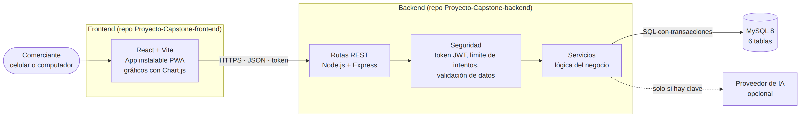

# Vendix — Backend (API REST)

**API del sistema de gestión de ventas e inventario para pequeños negocios.**  
Proyecto APT · Ingeniería en Informática · Duoc UC Valparaíso

<p align="center">
  <a href="https://vendixapp.online"><strong>🌐 Aplicación publicada</strong></a>
</p>

<p align="center">
  
  
  
  
</p>


## Descripción

Vendix Backend es la API REST que centraliza la lógica de negocio, autenticación, validaciones y acceso a datos de Vendix. Se comunica con el frontend React y almacena la información en una base de datos compatible con MySQL, desplegada en TiDB Cloud. También integra Azure AI Foundry para el asistente inteligente.


## Evidencias visuales

<p align="center">
  " alt="Pantalla de Vendix" width="48%">
  " alt="Vista de Vendix" width="48%">
</p>

## Responsabilidad del backend

- Registro e inicio de sesión de usuarios mediante correo y contraseña.
- Autenticación de solicitudes protegidas mediante JWT.
- Gestión de productos, precios, categorías y existencias.
- Registro y anulación de ventas, con control de stock.
- Estadísticas e indicadores de ventas e inventario.
- Alertas y consultas relacionadas con el negocio.
- Asistente de IA conectado a Azure AI Foundry (GPT-5-mini), ejecutado desde el backend.
- Separación de datos por usuario autenticado.

## Tecnologías

| Área | Tecnología |
|---|---|
| Runtime | Node.js 20+ |
| Framework | Express |
| Base de datos | TiDB Cloud, compatible con MySQL |
| Autenticación | JWT y contraseñas con hash |
| IA | Azure AI Foundry — GPT-5-mini |
| Pruebas | Suite automatizada y pruebas de humo |
| Despliegue | Render |

## Arquitectura



El frontend realiza solicitudes HTTP a la API. Las rutas reciben las solicitudes, los middleware aplican autenticación y controles transversales, los servicios contienen la lógica de negocio y el módulo de base de datos ejecuta consultas y transacciones. Las llamadas al proveedor de IA se hacen desde el backend para no exponer credenciales al cliente.

## Requisitos

- [Node.js](https://nodejs.org/) 20 o superior.
- npm.
- MySQL 8 local o TiDB Cloud para ejecución local (compatibilidad MySQL).
- Node.js 22.13 o superior para ejecutar el conjunto completo de pruebas, según la configuración del proyecto.
- Docker y Docker Compose son opcionales si se utiliza la configuración de contenedores.

## Instalación (Windows / PowerShell)

```powershell
# Clona el repositorio y entra a Codigo
git clone https://github.com/danieldelta93/Proyecto-Capstone-backend.git
cd Proyecto-Capstone-backend\Codigo
npm install
Copy-Item .env.example .env
```

Edita `.env` con tus valores locales. Configura, como mínimo, la conexión a la base de datos y `JWT_SECRET`. Genera un secreto aleatorio con:

```powershell
node -e "console.log(require('crypto').randomBytes(32).toString('hex'))"
```
No subas `.env` ni compartas claves, contraseñas, certificados privados o tokens.

## Base de datos

### Opción A: Docker

```powershell
docker compose up -d
```
Esta configuración levanta MySQL y prepara las tablas según el esquema incluido. Para levantar también la API mediante el perfil completo, consulta `docker-compose.yml` y utiliza el perfil documentado en el proyecto.

### Opción B: MySQL local

Con MySQL instalado y activo, inicializa la base de datos usando el script disponible:

```powershell
npm run db:init
```

> El comando de reinicio de base de datos, si se utiliza, puede eliminar tablas y datos. No lo ejecutes sobre datos que quieras conservar.

## Ejecución de la API

```powershell
npm run dev   # desarrollo, reinicio automático
# o
npm start     # ejecución normal
```

La API local se inicia normalmente en `http://localhost:3000/api`. Verifica la conexión mediante:

- Local: `http://localhost:3000/api/salud`
- Producción: [https://vendix-backend-k6te.onrender.com/api/salud](https://vendix-backend-k6te.onrender.com/api/salud)

El endpoint de salud informa si la API puede conectarse a la base de datos.

## Pruebas

```powershell
npm test
npm run smoke
```

- `npm test`: suite automatizada de lógica de negocio, seguridad, autenticación, estadísticas, asistente y rendimiento. El README anterior registra 63 pruebas base y 69 al incluir pruebas de sesiones JWT; Node 22.13+ para la suite completa.
- `npm run smoke`: comprobaciones de flujo integrado de registro, login, productos, ventas, stock, panel, asistente, anulación y aislamiento entre cuentas. Ejecuta las pruebas contra un entorno de prueba local, nunca contra la base de producción.


## Asistente con IA

Vendix integra Azure AI Foundry con el modelo GPT-5-mini. El backend prepara el contexto de información del negocio y realiza la solicitud al servicio de IA. La clave y configuración del proveedor se mantienen en variables de entorno del servidor. Si el servicio de IA no está configurado o no responde, el asistente dispone de una ruta alternativa basada en reglas, de acuerdo con la implementación.

## Configuración y variables de entorno

La configuración se define mediante `.env` y se ejemplifica en `.env.example`. Entre las variables principales están:

- `PORT`: puerto del servidor.
- `DB_HOST`, `DB_PORT`, `DB_USER`, `DB_PASSWORD`, `DB_NAME`: conexión a la base de datos.
- `DB_SSL`, `DB_SSL_CA`: parámetros TLS para conexión segura cuando corresponda.
- `JWT_SECRET`, `JWT_EXPIRA`: firma y duración de tokens.
- `CORS_ORIGENES`: orígenes frontend permitidos.
- `LLM_API_KEY`, `LLM_BASE_URL`, `LLM_MODELO`: conexión al proveedor de IA.

Usa valores propios para el entorno local. No incluyas valores secretos en el README, repositorio, capturas ni registros.

## Despliegue

- **Backend:** Render.
- **Frontend de producción:** [https://vendixapp.online](https://vendixapp.online).
- **API:** [https://vendix-backend-k6te.onrender.com](https://vendix-backend-k6te.onrender.com).
- **Base de datos:** TiDB Cloud, conexión TLS.

El despliegue requiere configurar las variables de entorno del servicio en Render y mantener los orígenes permitidos de CORS alineados con el dominio publicado. No se deben subir certificados ni secretos al repositorio.

## Documentación

La documentación técnica está en [`Codigo/docs/`](Codigo/docs/):

- [Arquitectura](Codigo/docs/ARQUITECTURA.md)
- [Modelo de datos](Codigo/docs/MODELO_DE_DATOS.md)
- [API](Codigo/docs/API.md)
- [Pruebas HTTP](Codigo/docs/pruebas.http)

La documentación académica, Scrum, planificación, diagramas, manual técnico y evidencias de las fases están en `Documentacion/` y `FASE 1/`, `FASE 2/`, `FASE 3/`.

## Estructura del repositorio

```text
Codigo/
  src/              servidor, rutas, servicios, middleware, utilidades y conexión DB
  database/          esquema de base de datos
  pruebas/           pruebas automatizadas
  scripts/           inicialización y pruebas de humo
  docs/             arquitectura, modelo de datos, API y pruebas HTTP
  Dockerfile         configuración de imagen
  docker-compose.yml  servicios de contenedores
Documentacion/       documentación del proyecto e imágenes UML
FASE 1/ FASE 2/ FASE 3/ evidencias y entregables académicos
```


## Equipo

| Integrante | Responsabilidad principal |
|---|---|
| Esteban Guajardo | Frontend, interfaz UX/UI y usabilidad |
| Daniel Troncoso | Backend, base de datos, IA y despliegue |


## Metodología

Scrum, con sprints de dos semanas y artefactos como Product Backlog, Sprint Backlog, Definition of Done y retrospectivas. El equipo priorizó funcionalidades, distribuyó tareas, revisó avances y ajustó el trabajo durante el desarrollo.

## Estado del proyecto

Backend desplegado y conectado a TiDB Cloud; frontend publicado en [vendixapp.online](https://vendixapp.online). Incluye los módulos de usuarios, productos, ventas, estadísticas y asistente de IA. Para conocer la configuración de ejecución y las pruebas, revisa las secciones anteriores y la documentación técnica.

## Conexión con el frontend

El frontend se ejecuta localmente en `http://localhost:5173` y la API en `http://localhost:3000`. La variable `CORS_ORIGENES` controla qué orígenes pueden comunicarse con la API. En producción, debe incluir el dominio publicado del frontend y conservar los orígenes necesarios para desarrollo.

Frontend: [Proyecto-Capstone-frontend](https://github.com/danieldelta93/Proyecto-Capstone-frontend).  
Aplicación: [https://vendixapp.online](https://vendixapp.online).

## Cambios en GitHub

```powershell
git add .
git commit -m "Describe el cambio"
git push
```
